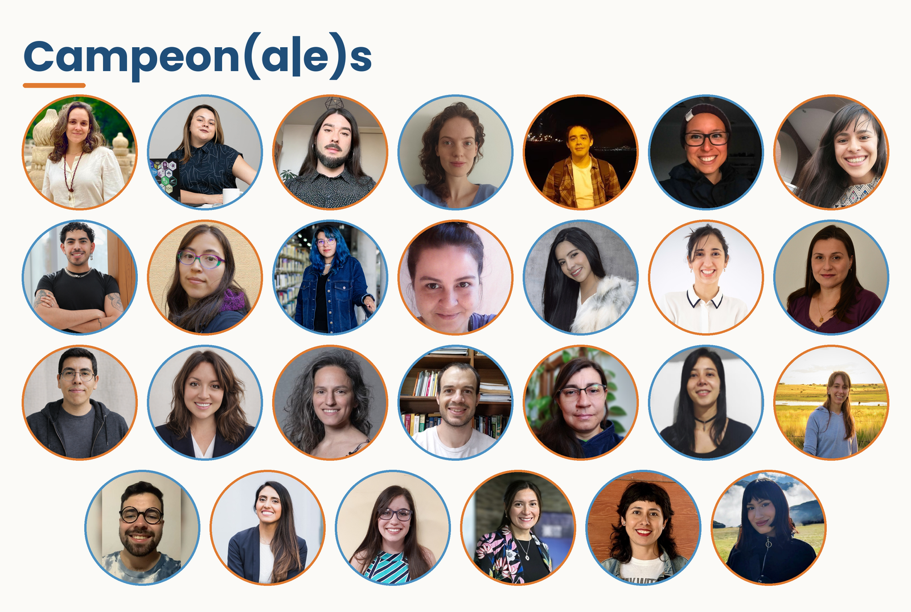
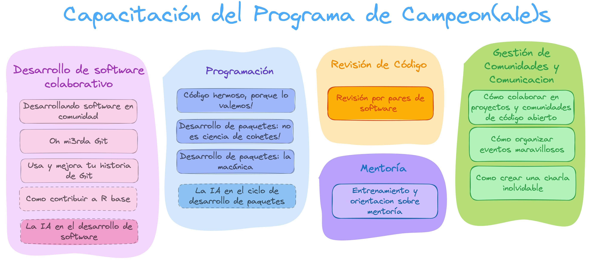
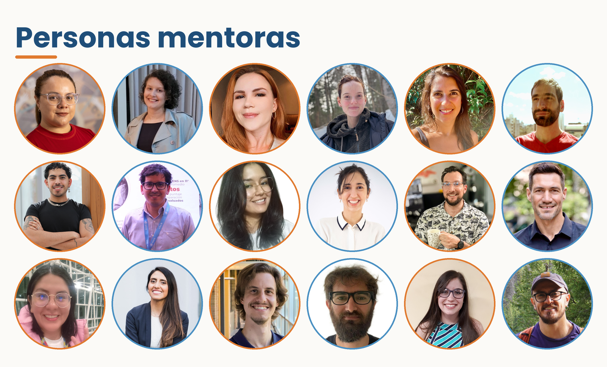
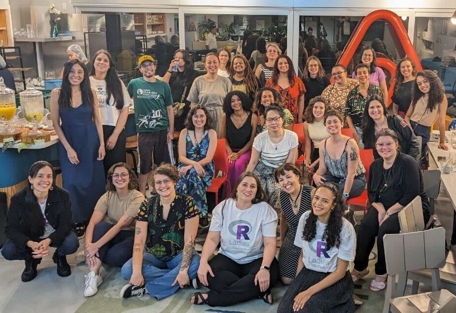
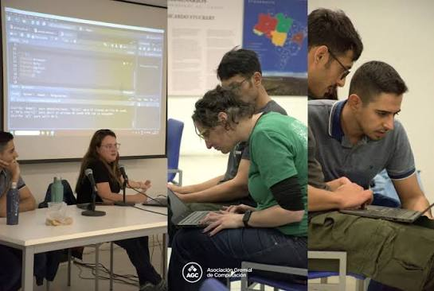
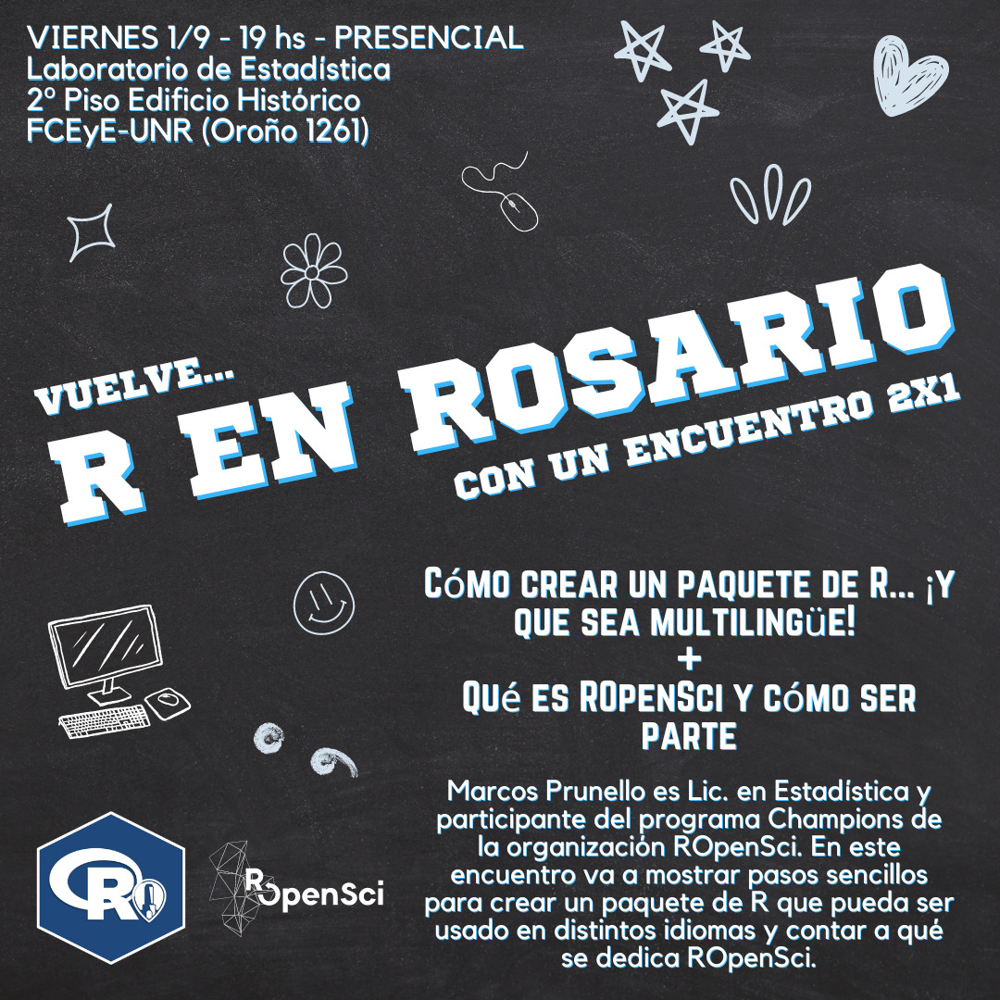
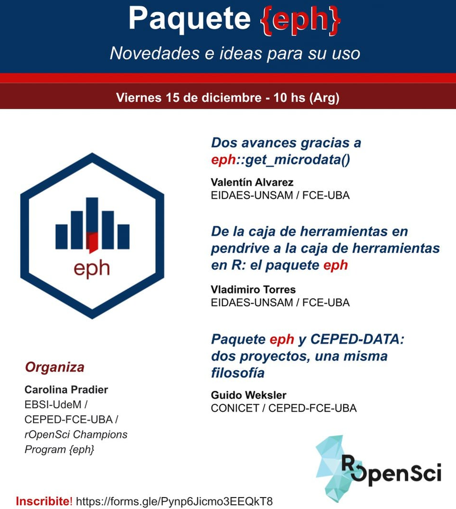

## ¿Qué es el programa?

:::: {.columns}
::: {.column width="55%"}
::: {.tarjeta}
**Un año** de acompañamiento para personas que desarrollan código de R
:::
::: {.tarjeta}
Pensado para **grupos históricamente subrepresentados** en el software abierto
:::
::: {.tarjeta .acento}
**4 cohortes** desde 2022, con un currículo que se revisa en cada edición
:::
:::
::: {.column width="45%"}
{fig-alt="Foto de campeonas y campeones del programa que son de America Latina"}
:::
::::

::: {.notes}
(1,5 min) Qué es, a quién está dirigido, cuánto dura. Presentar la foto de participantes de la region.
:::

## La brecha que queremos cerrar

::: {.frase}
Desarrollar un paquete de R es una **puerta de entrada** a la ciencia abierta.
:::

. . .

Pero muchas personas de **Latinoamérica** y otras regiones, no tienen acceso a trayectorias *estructuradas* y con *apoyo*.

. . .

::: {.frase}
Los tutoriales técnicos solos rara vez alcanzan.
:::

. . .

También hace falta orientación sobre **flujos de trabajo colaborativos**, **normas comunitarias** y la **infraestructura social** que sostiene los proyectos abiertos.

::: {.notes}
(2,5 min) Motivación: el paquete como puerta de entrada. Enfatizar que la brecha no es solo técnica.
:::

## Cuatro cohortes, dos en América Latina

::: {.linea}
::: {}
<b>2022</b>
Primera cohorte, en inglés
:::
::: {}
<b>2023–2024</b>
Segunda cohorte, en inglés
:::
::: {.latam}
<b>2025–2026</b>
Cohorte para América Latina, en castellano
:::
::: {.latam}
<b>2026–2027</b>
Cohorte para América Latina, en castellano
:::
:::

 

Cada cohorte mejoró el currículo: mentorías asignadas por **zona horaria e idioma**, el **tipo de proyecto**, los **temas** y la **duración** de los talleres.

::: {.notes}
(1,5 min) Verificar las fechas de las dos primeras cohortes (el documento dice "2022–2024" para ambas).
:::

## Un enfoque integral

:::: {.columns}
::: {.column width="50%"}
### Habilidades de desarrollo
::: {.tarjeta}
Código limpio · pruebas automatizadas · documentación · revisión de software por pares
:::
:::
::: {.column width="50%"}
### Construcción de comunidad
::: {.tarjeta .acento}
Trabajo colaborativo · contribución a proyectos abiertos · comunicación · organización de eventos · mentoría
:::
:::
::::

 

::: {.frase}
Ambas son igual de esenciales para sostener un paquete en el tiempo.
:::

::: {.notes}
(2 min) Lo que distingue a este currículo.
:::

## Cinco ejes temáticos

{fig-align="center" height="620" fig-alt="Esquema de los cinco ejes del currículo"}

::: {.chico}
Mentoría · Desarrollo colaborativo de software · Desarrollo de paquetes de R · Revisión de software · Gestión de comunidad y divulgación
:::

::: {.notes}
(2 min) Recorrer el esquema eje por eje. Cada eje está compuesto por talleres de dos horas.
:::

## De la versión 1.0 a la 4.0

| Eje temático | Versión 1.0 | Versión 4.0 | Sesiones (v4) |
|---|---|---|---|
| Mentoría | Formación para personas tutoras | Formación para personas tutoras | 1 |
| Desarrollo colaborativo | Contribución a R base; software en comunidad | Software en comunidad; Git básico y avanzado | 4 |
| Paquetes de R | Mecánica para principiantes; desarrollo avanzado | Código de calidad y estilo; mecánica (3 encuentros); avanzado; GenIA y paquetes de R | 5 |
| Revisión de software | Revisión por pares en rOpenSci | Revisión por pares; taller práctico | 2 |
| Comunidad y divulgación | Reuniones virtuales activas (PACT) | Contribuir a proyectos abiertos; charlas memorables; organizar eventos | 3 |

::: {.chico}
v1.0: 7 sesiones de 90 a 180 minutos → v4.0: **15 encuentros de 2 horas**
:::

::: {.notes}
(2 min) Mostrar la evolución: más encuentros, más cortos, y temas nuevos como Git avanzado, GenIA y organización de eventos.
:::

## La mentoría en el centro

:::: {.columns}
::: {.column width="45%"}
{fig-alt="Foto de personas mentoras del programa que son de America Latina"}
:::
::: {.column width="55%"}
::: {.tarjeta}
Cada persona campeona trabaja con una **persona mentora** durante el año
:::
::: {.tarjeta}
Emparejamiento por **zona horaria e idioma**
:::
::: {.tarjeta .acento}
Un encuentro de **formación específica** para quienes mentorean
:::
:::
::::

::: {.notes}
(1,5 min) Presentar a las personas mentoras de la foto.
:::

## Lo que encontró la evaluación independiente

::: {.chico}
Cohortes 2022–2024 · Evaluación del CSCCE con encuestas de salida y entrevistas individuales
:::

 

:::: {.columns}
::: {.column width="25%"}
::: {.cifra}
100%se sintió bienvenida e incluida
:::
:::
::: {.column width="25%"}
::: {.cifra}
100%tiene más confianza para contribuir al código abierto
:::
:::
::: {.column width="25%"}
::: {.cifra}
100%recomendaría el programa
:::
:::
::: {.column width="25%"}
::: {.cifra}
&gt;80%completó el programa
:::
:::
::::

 

Entre el **86% y el 100%** se sintió más preparada para desarrollar, mejorar y enviar paquetes a revisión por pares.

::: {.notes}
(2 min) Los números hablan solos; dejar una pausa.
:::

## Impacto más allá del programa

:::: {.columns}
::: {.column width="50%"}
**En las trayectorias**

- Paquetes publicados en CRAN
- Charlas en conferencias, incluida **LatinR**
- Oportunidades laborales y subsidios

**En las comunidades**

- Talleres dictados localmente
- Participación en RLadies+
- Traducción de recursos de ciencia abierta
:::
::: {.column width="50%"}
{fig-alt="Foto de impacto 1" width="40%"}
{fig-alt="Foto de impacto 3" width="40%"}
{fig-alt="Foto de impacto 2" width="40%"}
{fig-alt="Foto de impacto 4" width="40%"}
:::
::::

::: {.notes}
(2 min) Contar una historia concreta de alguna persona campeona, si se puede.
:::

## Materiales abiertos para reutilizar

::: {.tarjeta}
[Currículo](https://champions-curriculum.ropensci.org) **completo en castellano**, con **licencia abierta**
:::

::: {.progreso}

Castellano100%

Inglés60%

Portugués20%

:::

::: {.tarjeta .acento}
Próximamente: un **[sitio web unificado](https://campeones-web.netlify.app/)**, repositorios ordenados y una guía para contribuir
:::

 

::: {.frase}
¡Sumate al **hackathon en LatinR** para avanzar con las traducciones!
:::

::: {.notes}
(1,5 min) Invitación a la comunidad latinoamericana a reutilizar los materiales. Contar que estamos trabajando en la traducción al inglés (60%) y al portugués (20%). Invitar al hackathon de LatinR, donde vamos a trabajar en las traducciones: cualquier persona puede venir a colaborar. Los materiales también se pueden adaptar a otros contextos de enseñanza y de comunidad.
:::

## ¡Gracias! {.center}

::: {.frase}
Te esperamos en HackeaR (Viernes 13 de noviembre de 8 a 10 am, Auditorio 2) para trabajar los materiales y contribuir a otros proyectos de R.
:::

**Materiales del currículo**
[https://champions-curriculum.ropensci.org](https://champions-curriculum.ropensci.org)

 

**Yanina Bellini Saibene**

::: {.redes}
[yabellini.netlify.app](https://yabellini.netlify.app)\
Mastodon [@yabellini@rstats.me](https://rstats.me/@yabellini)\
Bluesky [@yabellini.bsky.social](https://bsky.app/profile/yabellini.bsky.social)\
GitHub [yabellini](https://github.com/yabellini)\
LinkedIn [yabellini](https://www.linkedin.com/in/yabellini)
:::

::: {.notes}
(1 min + preguntas)
:::
